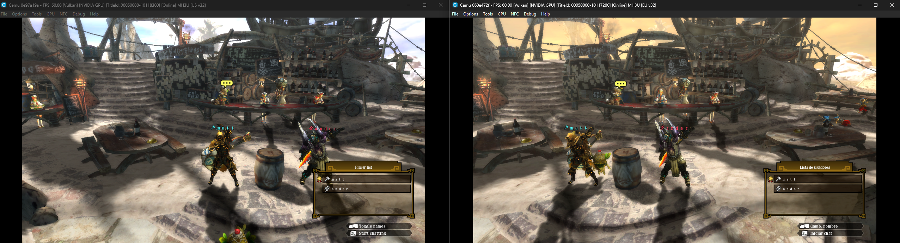
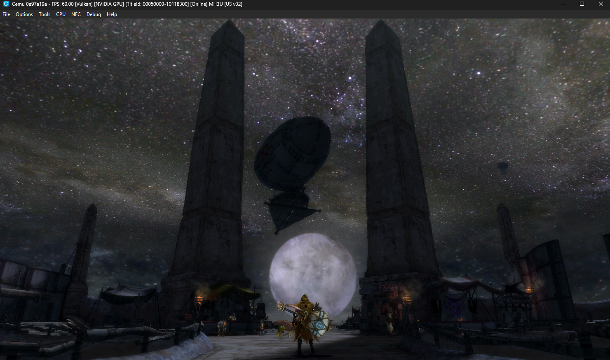

# Loc Lac City for Monster Hunter 3 Ultimate

Loc Lac City from Monster Hunter Tri, brought into Monster Hunter 3 Ultimate on Cemu. It takes
the place of Port Tanzia: go to the port the way you always do and you arrive in Loc Lac. It is not
an exact 1:1 of the original Loc Lac, but that was part of the goal. Keep some of Tanzia alive and
make it a fun and useful replacement with the npc customization.

Version 0.2.0-beta. Works with the US, EU and Japanese versions.

▶ [Watch the 6-minute showcase on YouTube](https://youtu.be/8axcP6V4mkg)

## What's in it

- **The city:** the gate, the streets, the market and the tavern, with its animated airship,
  balloons, gears and torches. The camera works like it did in Tri.
- **People and shops:** the city's stalls and vendors, the farm and trade menus, and a City
  Greeter with a few new things to say.
- **The tavern:** seats (with food), the item box, the quest board, departures and arm wrestling.
- **A room to decorate,** with Chamberlyne and a Poogie.
- **Tri's music,** with Loc Lac's own day and night themes.
- **Day and night,** swapping every real hour like in Tri.
- **The Jhen Mohran sandstorm:** sand in the sky and on the wind, with its own music. Switch it on
  whenever you like.

Everything is inside one Cemu graphic pack. Your game files are never changed, and turning the
pack off brings Port Tanzia back.

## What you need

- **Cemu** (a recent 2.x version), preferably my fork, since that's what the pack was tested on.
  It comes with [MH3U Revival](https://github.com/Matt-Wood-23/mh3u-revival).
- **Monster Hunter 3 Ultimate, US or EU, with the v1.3 update installed.** In Cemu's game list
  the game should show version **v32**. Without the update the pack can't work: the town files
  load but the rest doesn't.
- **Or the Japanese version (MH3G HD Ver.) with its v96 update.** Cemu's game list should show
  **v96**. The Japanese game needs some extra Cemu setup before it boots at all: see
  [JP version — extra setup](https://github.com/Matt-Wood-23/mh3u-revival/blob/main/docs/TROUBLESHOOTING.md#jp-version-mh3g-hd-ver--extra-setup)
  on the MH3U Revival page. If the Japanese game already runs on your Cemu, you're set.

## Install

1. Download `LocLacCity_0.2.0-beta.zip` from the Releases page. The same zip works for the US,
   EU and Japanese versions.
2. In Cemu, open **File → Open Cemu folder**, then open the `graphicPacks` folder.
3. Copy the `MH3U_LocLac` folder from the zip into `graphicPacks`. You should end up with
   `graphicPacks/MH3U_LocLac/rules.txt`, not `MH3U_LocLac/MH3U_LocLac/...`.
   - Don't put it inside `downloadedGraphicPacks`. Cemu empties that folder whenever it
     downloads the community packs.
4. Open **Options → Graphic packs** and go to **Monster Hunter 3 Ultimate → Mods → Loc Lac
   City**. Tick it.
5. Start the game and head to Port Tanzia. You'll arrive in Loc Lac.

## Settings

Choose these in the Graphic packs window when you tick the pack. If the game is already running,
restart it after changing them.

| Setting | Choices |
| --- | --- |
| Day and night | **Hourly** (like Tri: day and night swap every real hour), **Half-hourly** (night from :30 to :59), **Always day**, **Always night** |
| Sandstorm (Jhen Mohran event) | **Off**, **On** |

## Playing online

The pack works in online rooms, for example with the
[MH3U Revival](https://github.com/Matt-Wood-23/mh3u-revival) server. Everyone in the room should
use the pack, and the same version of it. A player without the pack can still join you on
quests, but in town you'll see each other in odd places, because their Port Tanzia and your Loc
Lac are laid out differently.

Players on the Japanese version can share a room with US and EU players, as long as everyone
uses the pack.

## Updating and removing

- **To update:** delete the old `MH3U_LocLac` folder first, then copy in the new one.
- **To remove:** untick the pack in the Graphic packs window, or delete the `MH3U_LocLac` folder.
  Port Tanzia comes back.
- **Your save** keeps working either way: a save played with the pack loads fine without it.

## Known issues

- The room's furniture layout isn't saved. It resets the next time you play.
- The City Greeter speaks English in every language. In the Japanese version his lines are
  wrapped to fit its narrower text box, so his conversations take a few more boxes.
- Changing a setting needs a game restart.

## Problems and feedback

Please open an issue on this project's GitHub page:
<https://github.com/Matt-Wood-23/mh3u-loc-lac/issues>.

If the town doesn't work, include Cemu's `log.txt` (it's in the Cemu folder). A working setup
lists four lines starting `Applying patch group 'MH3U_LocLac_`.

## 日本のプレイヤーの皆さまへ

バージョン0.2.0-betaから、日本版『モンスターハンター3（トライ）G HD Ver.』に対応しました。
北米版・欧州版と同じzipで動作します。

**必要なもの**

- 『モンスターハンター3（トライ）G HD Ver.』と更新データ v96（Cemuのゲームリストで v96 と表示されます）
- 日本版が起動するCemu。日本版の起動には追加の設定が必要です。MH3U Revival の
  [JP version — extra setup](https://github.com/Matt-Wood-23/mh3u-revival/blob/main/docs/TROUBLESHOOTING.md#jp-version-mh3g-hd-ver--extra-setup)
  をご覧ください（英語）。すでにCemuで日本版が遊べている場合は、そのままで大丈夫です。

**導入方法**

1. Releases ページから `LocLacCity_0.2.0-beta.zip` をダウンロードします。
2. Cemuで **File → Open Cemu folder** を開き、`graphicPacks` フォルダを開きます。
3. zipの中の `MH3U_LocLac` フォルダを `graphicPacks` にコピーします。
   `graphicPacks/MH3U_LocLac/rules.txt` となるように置いてください。
   `downloadedGraphicPacks` の中には入れないでください（コミュニティパックのダウンロード時に中身が消えます）。
4. **Options → Graphic packs** を開き、**Monster Hunter 3 Ultimate → Mods → Loc Lac City** にチェックを入れます。
5. ゲームを起動して、いつものようにタンジアの港へ向かうと、ロックラックに到着します。

**設定**（Graphic packs の画面で選びます。変更したらゲームを再起動してください）

- Day and night（昼と夜）: Hourly（トライと同じく1時間ごとに昼夜が切り替わります）、Half-hourly（毎時30分〜59分が夜）、Always day（常に昼）、Always night（常に夜）
- Sandstorm（ジエン・モーラン襲来時の砂嵐）: Off / On

**ご注意**

- 「ロックラック案内所」のNPCのセリフは英語のままです。日本版のテキスト欄に収まるよう改行しているため、
  会話のページ数が少し多くなっています。
- オンラインでは、部屋の全員がこのパック（同じバージョン）を使ってください。日本版と北米版・欧州版の
  プレイヤーは同じ部屋で遊べます。
- 更新するときは、古い `MH3U_LocLac` フォルダを削除してから新しいものをコピーしてください。

不具合やご意見は、GitHubの Issues へお気軽にどうぞ（日本語で大丈夫です）。

## Credits

Loc Lac City, its music and Monster Hunter are © Capcom. This is an unofficial fan project, not
made or endorsed by Capcom. You need your own copy of Monster Hunter 3 Ultimate to use it.

## AI disclosure

This mod was made with a lot of help from AI (Claude, by Anthropic): working out how the game is
built, writing the patches and tools, drafting the City Greeter's new lines, and writing this
page. I directed the work, picked and edited the lines, and tested everything in-game. There is
no AI-generated art or music: every model, texture and track comes from Capcom's own games.
